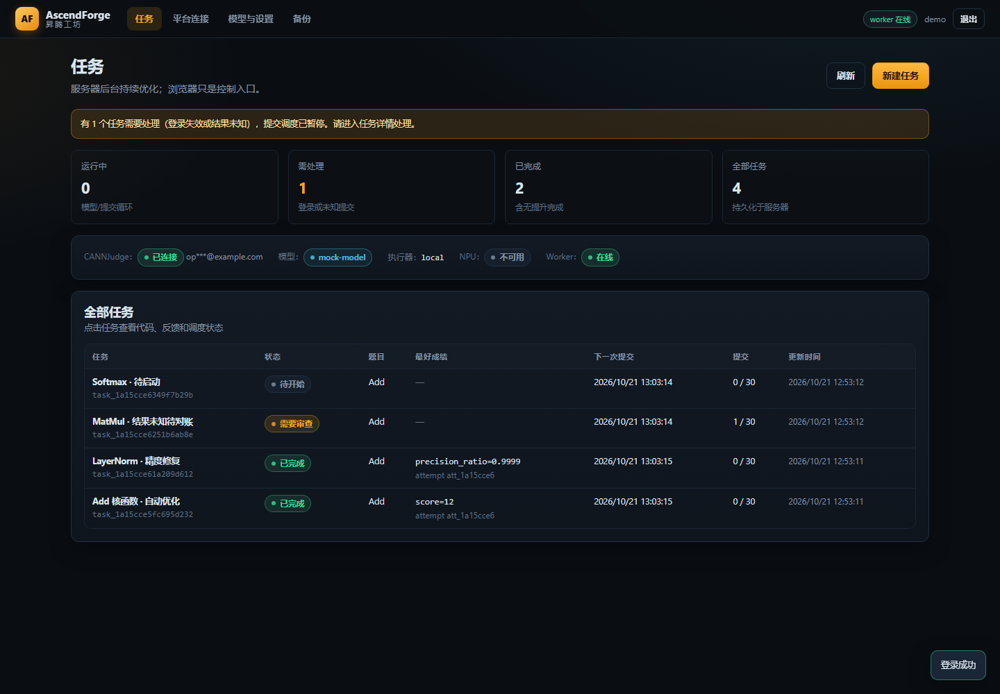
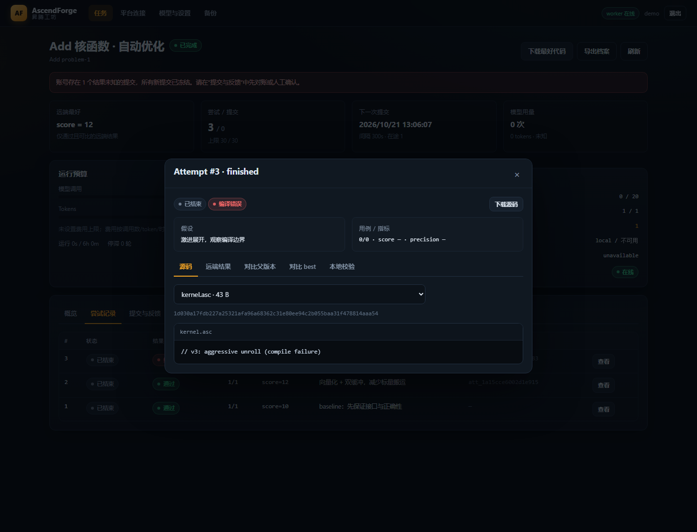
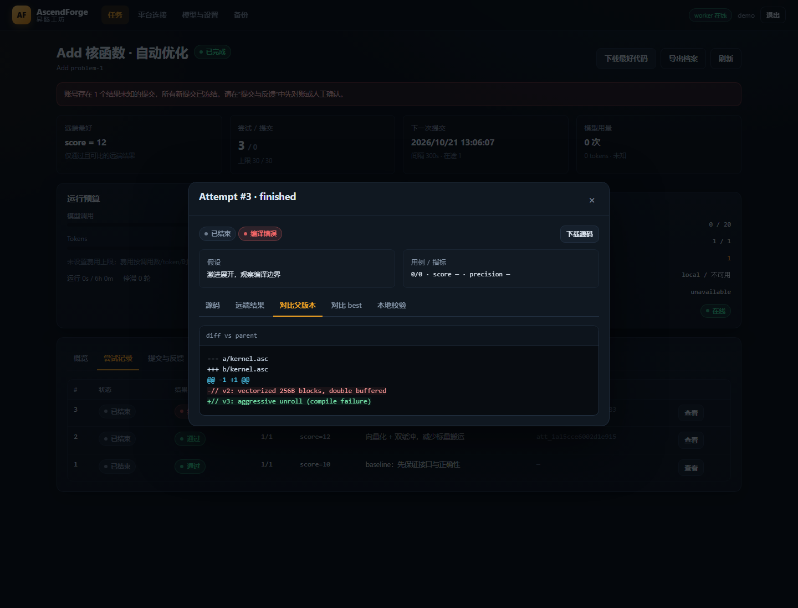

# AscendForge · 昇腾工坊

Agent 驱动的昇腾算子自动优化平台。首个远端评测平台为 **CANNJudge**。

服务器托管优化循环、模型调用、调度、实验存储和提交；本地主机只需要浏览器。关闭网页、电脑关机或 Web 服务重启都不会丢失任务，后台 worker 会从持久化状态恢复。

> **当前验证状态（2026-10-21）**
>
> - CANNJudge 的公开题目解析、模板读取、ZIP 工程下载已在本机**真实联网验证**。
> - **真实登录与题目权限已由用户在 Web 上完成验证**（账号已连接，Cookie 加密保存，未保存密码）；**真实提交/结果尚未完成**，界面和文档明确标注 `documented_endpoint_verified_not_submitted`。
> - 服务器环境（HiDevLab 950 系列）仍在审批中；本机无 NPU，因此所有 Ascend C 候选都标为 `unavailable/untested`，不会伪造设备结果。
> - 56 个自动化测试通过（mock/HTTP 层）；mock 通过不等于真实 CANNJudge 接入成功。
> - 没有模型 API 时，可在任务详情点击 **“提交基线（手动）”**：只提交一次模板可编辑文件，用来验证真实登录/提交/结果链路，不经过模型。

## 界面预览

本机 headless Chrome 实际截图（演示数据；非真实 CANNJudge 提交）：







## 为什么是这个形态

- **单用户、单服务器**：Python 标准库 + SQLite + 独立 worker，部署简单，故障面小。
- **浏览器只是控制面**：开始/暂停/恢复/停止只是写入意图；模型调用、提交、轮询都在服务器 worker 里。
- **凭据与模型上下文隔离**：模型只看到题目、源码和历史；API key、CANNJudge Cookie 只存在于加密凭据存储中。
- **保守的提交语义**：先落盘不可变快照，再提交完全相同的字节；超时/响应丢失进入 `submission_unknown`，先对账，绝不自动重发。
- **诚实的设备状态**：无 NPU 时只运行数据生成器和 CPU 参考实现，候选状态为 `untested`。

## 快速开始

### 1. 环境

- Python **3.11+**
- 唯一运行时依赖：`cryptography`（凭据加密）
- 推荐：Linux 服务器 + Docker（用于隔离执行生成代码）+ 反向代理 HTTPS

```bash
python3 -m venv .venv
. .venv/bin/activate
pip install -r requirements.txt
```

### 2. 初始化

```bash
export ASCENDFORGE_DATA_DIR=/var/lib/ascendforge
python -m ascendforge init            # 交互创建管理员，并生成数据目录/主密钥
```

也可以跳过 `init`，直接启动 Web 服务，在浏览器首次初始化页面输入控制台打印的一次性 setup token。

### 3. 启动（两个进程）

```bash
# 终端/服务 1：Web/API
python -m ascendforge serve --host 0.0.0.0 --port 8080

# 终端/服务 2：后台优化 worker
python -m ascendforge worker
```

生产环境请用 systemd 或容器编排托管两个进程，**不要让 worker 依赖 SSH 会话**。参考 [deploy/](deploy/)。

### 4. 在浏览器中

1. 打开 `http://<server>:8080`，登录 AscendForge。
2. **平台连接**：输入用户提供的 CANNJudge 账号和密码，并填写一道用于验证权限的题目链接。登录在服务器完成；密码不落库，只保存加密的会话 Cookie 与用户 ID。若账号无法访问该题目，会明确返回“账号无法连接 judge”。
3. **模型与设置**：填写中转站/模型 `base_url`、`api_key`、模型名。可测试连接。
4. **新建任务**：粘贴完整 CANNJudge 题目链接，设置预算。
5. **开始**：worker 会创建快照、调用模型、排队提交、轮询结果并迭代。
6. 任务详情可看源码、远端结果、diff、调度额度、预算；可下载 best 源码、指定版本和完整任务档案。

Windows 开发（本仓库当前开发机）：

```powershell
$env:PYTHONPATH = "D:\AscendForge"
$env:ASCENDFORGE_DATA_DIR = "D:\AscendForge\data"
D:\python\python.exe -m ascendforge serve
D:\python\python.exe -m ascendforge worker
```

## 常用命令

```bash
python -m ascendforge status                    # 任务/worker/能力概览
python -m ascendforge serve                     # Web/API
python -m ascendforge worker                    # 后台优化
python -m ascendforge backup                    # 服务器备份（默认不含主密钥）
python -m ascendforge verify-backup <dir>       # 备份完整性检查
python -m ascendforge restore <dir> --force     # 恢复（会覆盖目标数据目录）
python -m ascendforge user list
python -m ascendforge probe --url https://cannjudge.cn/home
```

任务档案下载：任务详情 → “导出档案”。档案包含源码快照、父子关系、生成器、种子、远端结果、原始反馈和 SHA-256；默认排除凭据、会话、日志。

## 目录结构

```text
ascendforge/
  web.py                 HTTP/API/静态 UI（标准库，无前端构建）
  webui/                 index.html / style.css / app.js
  worker.py              独立后台循环
  scheduler.py           持久化队列、限频、预算、对账
  tasks.py               任务状态机与配置校验
  experiments.py         快照、结果归一化、best、档案导出
  security.py            scrypt 密码、Fernet 凭据、会话、CSRF
  platform/
    base.py              平台适配器契约
    cannjudge.py         CANNJudge 实现
    service.py           连接/会话/题目导入
  agent/
    protocol.py          版本化工具协议 + JSON Schema 校验
    providers.py         OpenAI 兼容 Provider + Mock
    runtime.py           单步 Agent Runtime
    tools.py             宿主工具执行
    prompts.py, skills.py
  execution/
    executor.py          Docker / 本地子进程隔离执行
    capabilities.py      NPU/CANN/Docker 诚实检测
  backup.py, cli.py, db.py, states.py
skills/                  三个显式加载的 SKILL.md
tests/                   56 个 unittest
deploy/                  systemd / Docker / Caddy / Nginx
docs/                    架构、能力矩阵、阶段 0 报告、运维、安全、验收
```

## 数据布局

```text
$ASCENDFORGE_DATA_DIR/
  ascendforge.db          SQLite（WAL）
  secrets/master.key      Fernet 主密钥（务必单独备份）
  secrets/setup.token     首次初始化令牌
  tasks/<task_id>/
    problem/package.zip   原始题目工程包
    problem/project/      解压后的模板
    snapshots/<id>/files/ 不可变源码快照（含 manifest.json）
  backups/
  logs/ascendforge.log    轮转日志
  tmp/                    导出/下载临时文件
```

## 关键语义

| 场景 | 行为 |
|---|---|
| 网页关闭 / 断网 | worker 继续；重连后从服务端拉取完整状态 |
| Web 服务重启 | worker 不受影响；状态全在 SQLite/磁盘 |
| worker 崩溃 | 重启后 `submitting` 超租约的提交标记 `unknown`，先对账 |
| 提交超时/无 submissionId | `submission_unknown` + `needs_review`，冻结新提交，等待对账 |
| 暂停 | 禁止新模型调用/执行/提交；已发出的提交继续收集结果 |
| 停止 | 不撤销远端已接受提交；取消尚未发送的排队提交 |
| 401/403 | 进入 `needs_login`/`needs_review`，不盲目重试 |
| 429 | 遵守 `Retry-After`，有上限退避 |
| 无 NPU | 数据/参考结果可跑；候选 `unavailable/untested` |
| 自定义远端测试 | 未核实，禁用 |
| best 更新 | 仅远端“通过且指标可比且不退化”的新版本；失败/编译错误不覆盖 |
| 重放请求 | `X-Request-Id` 幂等键 + 状态机；开始/暂停/恢复/停止幂等 |

## 安全边界

- 密码 scrypt（每用户盐）；会话令牌只在 DB 存 SHA-256。
- 模型 key 与 CANNJudge Cookie 用 Fernet 加密，密钥在数据库之外；浏览器只看到掩码。
- 生成代码在独立子进程或 Docker 中执行：临时工作目录、最小环境、输出/时间/内存限制；Docker 模式禁网。**本地子进程回退不能强制禁网**，能力页会明确提示，服务器推荐 Docker。
- 导出档案默认排除凭据/会话/日志；备份默认不含主密钥。
- 远程访问必须经 HTTPS 反向代理，并设置 `ASCENDFORGE_SECURE_COOKIES=true`。

详见 [docs/security.md](docs/security.md)。

## 测试

```bash
PYTHONPATH=. python -m unittest discover -s tests -t . -v
```

覆盖：快照不可变与篡改检测、提交限频/每日额度/在途上限、并发原子领取、重启后限频保持、未知提交冻结与对账、人工恢复、两轮 mock 优化与失败不覆盖 best、CSRF/幂等、凭据掩码、档案排除密钥、备份校验/恢复、隔离执行器超时/输出上限/环境清洗、CANNJudge 提交载荷校验、生成器/参考实现隔离执行、任务状态机与 skills 加载。

## 尚未验证 / 需要你完成

1. **真实 CANNJudge 登录 + 一次真实提交**：需要你在 Web「平台连接」中输入账号密码（推荐的唯一安全方式），并在任务中授权提交。当前所有真实提交状态都是“未验收”。
2. **服务器**：HiDevLab 950 审批下来后，部署 `serve` + `worker`，确认 Docker/CANN/NPU 能力；无 NPU 的开发机不能替代。
3. **模型 Provider**：需要你提供中转站 base_url、key、模型名；不同网关对 `tools` 字段、JSON 输出和计费字段的兼容性需要实测。
4. **HTTPS/域名**：远程访问前配置反向代理与 `ASCENDFORGE_SECURE_COOKIES=true`。

## 文档

- [架构与状态机](docs/architecture.md)
- [CANNJudge 能力矩阵与证据](docs/capability-matrix.md)
- [阶段 0 真实探测报告](docs/phase0-report.md)
- [部署与运维](docs/operations.md)
- [安全模型](docs/security.md)
- [验收清单](docs/acceptance.md)
- [Agent 工具协议](docs/protocol.md)
